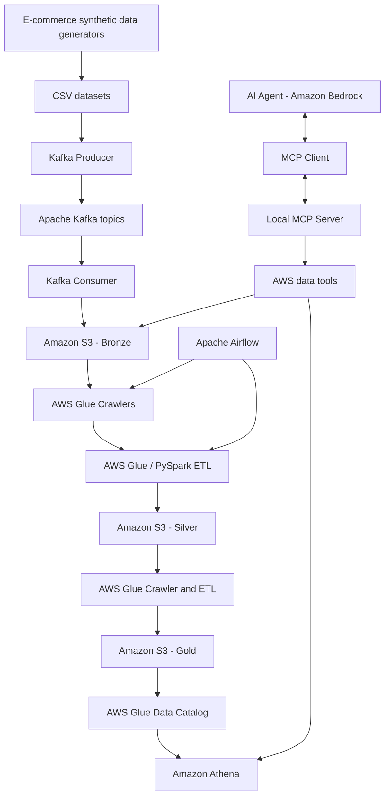

# AI-Augmented E-Commerce Data Platform

An end-to-end data engineering project that combines **event streaming, AWS-based data lake processing, workflow orchestration, analytics, and a conversational AI agent**. The platform simulates e-commerce activity, streams events through Apache Kafka, lands raw records in Amazon S3, transforms data through a Bronze–Silver–Gold architecture, and exposes AWS data tools to an AI assistant through the Model Context Protocol (MCP).

> **Project status:** This repository contains the implementation and supporting setup/interview documentation. Running the complete workflow requires AWS resources and credentials configured in your own environment.

## Architecture



## Key capabilities

- **Synthetic e-commerce data generation:** Python generators create customer, product, order, session, and clickstream datasets.
- **Event streaming:** A Kafka producer publishes dataset records to topic-specific event streams.
- **Data ingestion:** A Kafka consumer processes events, writes local JSON records, and uploads raw events to Amazon S3.
- **Medallion data lake:** AWS Glue jobs and crawlers support Bronze, Silver, and Gold processing stages.
- **Workflow orchestration:** An Apache Airflow DAG coordinates crawler and ETL dependencies, with retries and completion checks.
- **AI-assisted data interaction:** An Amazon Bedrock conversational agent discovers tools from a local MCP server and can invoke them to interact with the data platform.
- **DataOps checks:** GitHub Actions validates Python syntax, required project files, selected lint rules, and potential AWS credential leaks.

## Technology stack

| Area | Technologies |
|---|---|
| Language and data processing | Python, Pandas, PySpark |
| Event streaming | Apache Kafka, kafka-python |
| Cloud and storage | AWS, Amazon S3, AWS Glue, AWS Glue Data Catalog, Amazon Athena |
| Orchestration | Apache Airflow, Docker |
| AI integration | Amazon Bedrock, Anthropic Claude, Model Context Protocol (MCP), Boto3 |
| CI / DataOps | GitHub Actions, compileall, Flake8 |

## Data flow

1. **Generate:** Run the synthetic data generators to create CSV datasets for customers, products, sessions, clickstream events, and orders.
2. **Publish:** The Kafka producer reads available CSV files and publishes records to their configured Kafka topics.
3. **Ingest:** The Kafka consumer subscribes to event topics, writes JSON records locally, and uploads each event to the S3 Bronze prefix using time-based partitions.
4. **Transform to Silver:** Airflow triggers the Bronze crawler and the configured AWS Glue ETL job. The Silver layer is intended for validated, typed, columnar data.
5. **Transform to Gold:** Airflow triggers the Silver crawler and Gold transformation job. The Gold layer is intended to expose analytics-ready dimensional tables.
6. **Query:** The Gold crawler updates the Glue Data Catalog so curated tables can be queried with Amazon Athena.
7. **Ask the AI agent:** The Bedrock-powered agent uses MCP-discovered tools to perform supported data-platform operations.

The Airflow DAG is defined in `airflow/dags/ecommerce_pipeline.py` and sequences:

`crawl_bronze → bronze_to_silver → crawl_silver → silver_to_gold → crawl_gold`

## Repository structure

```text
.
├── ai_agent/                  # Bedrock agent, configuration, MCP client/server
├── airflow/
│   ├── dags/                  # Airflow data pipeline DAG
│   ├── Dockerfile
│   └── docker-compose.yml     # Local Airflow setup
├── docker/
│   └── docker-compose.yml     # Kafka service
├── generator/
│   ├── generators/            # Synthetic e-commerce data generators
│   ├── anomalies/              # Anomaly-related generation components
│   ├── producer.py            # Kafka event producer
│   ├── consumer.py            # Kafka-to-local/S3 consumer
│   ├── main.py                # Runs the data generators
│   └── config.py              # Kafka, AWS, topic and dataset settings
├── docs/                      # Project documentation
├── tests/                     # Test suite
├── AIRFLOW_ORCHESTRATION.md   # Airflow design and local setup notes
├── DATAOPS_CI_PIPELINE.md     # CI pipeline documentation
├── requirements.txt           # Root Python dependencies
└── README.md
```

## Prerequisites

Install or configure the following before running the relevant components:

- Python 3.10+ (use a version compatible with the pinned dependencies)
- Docker Desktop or Docker Engine with Docker Compose
- Java/runtime support as required by your local Kafka distribution
- An AWS account with appropriately scoped permissions for S3, Glue, Athena, and Amazon Bedrock
- AWS CLI credentials configured through an AWS profile or another secure credential provider
- Access to the selected Bedrock model in the configured AWS region

Do not commit AWS access keys, secret keys, session tokens, or private environment files to this repository.

## Getting started

### 1. Clone the repository

```bash
git clone https://github.com/priyanshukannaujiya/ai-augmented-data-platform.git
cd ai-augmented-data-platform
```

### 2. Create a Python environment

```bash
python -m venv .venv
```

Activate it:

```bash
# macOS / Linux
source .venv/bin/activate

# Windows PowerShell
.venv\Scripts\Activate.ps1
```

Install the root dependencies:

```bash
pip install -r requirements.txt
```

### 3. Generate synthetic datasets

From the repository root:

```bash
python -m generator.main
```

The producer configuration expects generated CSV files under `generator/data/`. Check `generator/config.py` and confirm that the generator output paths match those configured dataset paths before streaming.

### 4. Start Kafka

In a separate terminal, from the repository root:

```bash
docker compose -f docker/docker-compose.yml up -d
```

Check the container status:

```bash
docker compose -f docker/docker-compose.yml ps
```

### 5. Stream and ingest events

Keep Kafka running. Start the producer and consumer in separate terminals from the repository root:

```bash
python -m generator.producer
```

```bash
python -m generator.consumer
```

The producer publishes records to the configured topics. The consumer writes received records to the local Bronze directory and attempts to upload JSON events to the configured S3 bucket. Verify the topic names, bootstrap server, bucket, AWS region, and IAM permissions in the project configuration before running.

### 6. Run Airflow

The Airflow environment is defined in the `airflow/` directory:

```bash
cd airflow
docker compose build
docker compose up -d
```

Open [http://localhost:8080](http://localhost:8080) and sign in using the credentials configured by the local Compose setup. Inspect the Airflow DAG named `ai_augmented_ecommerce_pipeline`, configure the required AWS connection, and trigger it when the referenced Glue crawlers and jobs are available in your AWS account.

Stop Airflow with:

```bash
docker compose down
```

See [AIRFLOW_ORCHESTRATION.md](AIRFLOW_ORCHESTRATION.md) for the orchestration design and additional setup details.

### 7. Run the AI agent

Install the agent-specific dependencies if they are not already included in the root environment:

```bash
pip install -r ai_agent/requirements.txt
```

Configure AWS credentials and verify the Bedrock model ID and region in `ai_agent/config.py`. Then run the agent from the repository root:

```bash
python -m ai_agent.app
```

The agent starts a local MCP server as a subprocess, discovers its available tools, and uses the Bedrock Converse API to handle user prompts and tool calls. The exact operations available depend on the MCP server implementation and AWS permissions.

### 8. Stop Kafka

From the repository root:

```bash
docker compose -f docker/docker-compose.yml down
```

## Configuration checklist

Before running the cloud pipeline, review these settings and ensure they match resources in your AWS account:

- **Kafka:** Bootstrap server and topic names in `generator/config.py` and `generator/consumer.py`.
- **S3:** Bucket name and Bronze prefix used by the consumer.
- **AWS region:** Region settings in generator and AI agent configuration.
- **Glue:** Crawler names, ETL job names, IAM role, and Airflow AWS connection in `airflow/dags/ecommerce_pipeline.py`.
- **Bedrock:** Model or inference profile ID and region in `ai_agent/config.py`.
- **Athena:** Gold database and query-results S3 location in `ai_agent/config.py`.

Some resource names are project-specific placeholders or existing environment values. Update them to match your AWS account before execution. Grant only the permissions each component needs.

## CI / DataOps

The repository includes a GitHub Actions workflow for lightweight quality and security checks. The documented checks include:

- Python syntax compilation
- Required pipeline-file checks
- Critical Flake8 checks
- Basic scanning for patterns that resemble hardcoded AWS credentials

These checks improve code hygiene; they do not deploy AWS infrastructure or prove that cloud resources are configured correctly.

See [DATAOPS_CI_PIPELINE.md](DATAOPS_CI_PIPELINE.md) for details.

## Troubleshooting

- **Kafka connection refused:** Confirm the Kafka container is healthy and that the configured bootstrap address and advertised listener are reachable from the Python process.
- **No events are published:** Confirm the CSV files exist at the paths in `generator/config.py` and that the producer topic configuration matches the consumer subscriptions.
- **S3 upload fails:** Check the bucket name, region, network access, and IAM permissions. Confirm credentials are available to the process without placing secrets in source code.
- **Airflow task fails:** Review task logs and verify the AWS connection, Glue crawler names, job names, IAM role, and region.
- **Bedrock invocation fails:** Confirm model access, the configured model or inference profile ID, region support, and IAM permissions for the Bedrock runtime API.
- **Athena returns no tables:** Confirm the Gold ETL job completed, the Gold crawler ran successfully, and the correct Glue database is selected.

## Security notes

- Use AWS profiles, IAM roles, or another secure credential provider rather than hardcoding credentials.
- Keep `.env`, AWS credential directories, private keys, and local state files out of version control.
- Use least-privilege IAM policies for S3, Glue, Athena, and Bedrock.
- Review generated data before sharing it; do not put real customer or personally identifiable information into test datasets.

## Further documentation

- [Airflow orchestration](AIRFLOW_ORCHESTRATION.md)
- [DataOps CI pipeline](DATAOPS_CI_PIPELINE.md)
- [Apache Kafka documentation](https://kafka.apache.org/documentation/)
- [Apache Airflow documentation](https://airflow.apache.org/docs/)
- [Amazon S3 documentation](https://docs.aws.amazon.com/s3/)
- [AWS Glue documentation](https://docs.aws.amazon.com/glue/)
- [Amazon Bedrock documentation](https://docs.aws.amazon.com/bedrock/)

## Author

**Priyanshu Kannaujiya**

- GitHub: [@priyanshukannaujiya](https://github.com/priyanshukannaujiya)

---

If you find this project useful, consider giving the repository a ⭐.
